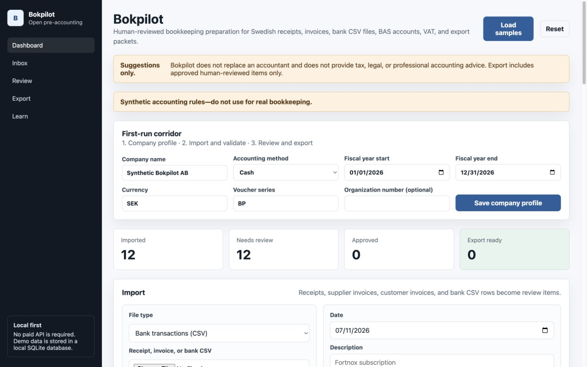

# Bokpilot

**Local-first pre-accounting assistant for Swedish small businesses.**

Bokpilot helps freelancers, micro-business owners, bookkeepers, accountants, and immigrant entrepreneurs prepare cleaner bookkeeping material before it reaches an accounting system. It imports receipts, invoices, and bank CSV rows; suggests BAS accounts and VAT treatment; explains the reasoning; requires human review; and exports approved-only JSON, CSV, or SIE-style draft packets.

It is not an autonomous accountant. Bokpilot generates suggestions only and does not provide professional accounting, tax, or legal advice.

## Why this exists

Small businesses often lose time before the actual bookkeeping starts: receipts are scattered, bank rows are unclear, VAT rates vary, BAS accounts are unfamiliar, and accountants receive incomplete material. Bokpilot focuses on the pre-accounting step: collect, classify, explain, review, and export.

The first version is deliberately local-first and dependency-light. It does not require Fortnox, Visma, Bokio, paid OCR, or an AI provider to run.

## What works in the MVP

- Import sample receipts, supplier invoices, customer invoices, and bank CSV transactions.
- Add manual transactions from the UI.
- Parse basic text documents with fields such as `Supplier`, `Date`, `Total`, `VAT`, and `Description`.
- Parse CSV files with common Swedish or English headers for date, description, signed amount, currency, or split debit/credit and in/out amount columns.
- Preserve bank CSV source filename and row number on imported items for reviewer traceability.
- Suggest BAS account mappings and VAT treatment using deterministic rules.
- Explain each suggestion in plain language.
- Show confidence, risk flags, and draft double-entry journal lines.
- Let a human approve, reject, keep open, or override BAS/VAT treatment.
- Export approved human-reviewed items only as JSON, CSV, or a basic SIE-style draft.
- Store data locally in `data/bokpilot.sqlite3` by default, with transactional writes and revision checks.
- Run tests without external services.

## Quick start

Requires Python 3.10 or newer.

```bash
python3 -m bokpilot --host 127.0.0.1 --port 8765
```

Open [http://127.0.0.1:8765](http://127.0.0.1:8765), then:

1. Select `Load samples`.
2. Open a review item.
3. Inspect the BAS/VAT reasoning and journal lines.
4. Approve one or more items.
5. Generate JSON, CSV, or SIE-style export output.

Use a separate local workspace file:

```bash
BOKPILOT_DATA_PATH=/tmp/bokpilot.sqlite3 python3 -m bokpilot --port 8765
```

Legacy JSON workspaces require an explicit, non-destructive migration:

```bash
python3 -m bokpilot migrate --from-json data/workspace.json --to-sqlite data/bokpilot.sqlite3
```

Create and restore integrity-checked local backups:

```bash
python3 -m bokpilot backup --to /tmp/bokpilot-backup.zip
python3 -m bokpilot restore \
  --from /tmp/bokpilot-backup.zip \
  --to /tmp/restored-bokpilot \
  --sha256 SHA256_PRINTED_BY_BACKUP
```

Run tests:

```bash
python3 -m unittest
```

Install the package and run the console command:

```bash
python3 -m pip install .
bokpilot --port 8765
```

To build a wheel in a temporary directory and smoke-test its installed web assets and sample data from outside the checkout:

```bash
python3 scripts/smoke_installed.py --build-wheel
```

## Demo flow

The sample dataset includes:

- `Fortnox subscription May` -> software expense, BAS 5420, 25% input VAT.
- `Pressbyran kontorsmaterial` -> office supplies, BAS 6110, 25% input VAT.
- `Customer invoice 2026-104 paid` -> Swedish sales, BAS 3011, output VAT 2611.
- `Bankavgift foretagskonto` -> bank fees, BAS 6570, no VAT.
- `SJ train ticket client meeting` -> travel, BAS 5800, 6% VAT, review flag.
- `Lunch with client Stockholm` -> meals/representation, review flag.
- `IKEA desk lamp workspace` -> small equipment, review flag.
- `Circle K fuel client visit` -> vehicle fuel, review flag.

Example input files ship inside [the Bokpilot package](bokpilot/resources/samples). Illustrative export snapshots live in [examples/exports](examples/exports).

## Screenshots

Desktop review and export flow:



Mobile responsive view:


## Project structure

```text
bokpilot/             Python backend, parsers, rules, data store, exporters
  resources/static/   Packaged web UI
  resources/samples/  Packaged Swedish demo receipt, invoice, and bank CSV inputs
examples/exports/     Example export snapshots
tests/                Standard-library unit tests
docs/                 Product brief, architecture, data model, workflows
```

## Documentation

- [Product brief](docs/product-brief.md)
- [Architecture](docs/architecture.md)
- [Data model](docs/data-model.md)
- [Example workflows](docs/example-workflows.md)
- [Safety and privacy](docs/safety-and-privacy.md)
- [Integration roadmap](docs/integration-roadmap.md)
- [Launch checklist](docs/launch-checklist.md)

## Safety principles

- Suggestions are drafts until a person approves them.
- Exports include approved items only.
- Risky areas such as representation, vehicle costs, cross-border VAT, reverse charge, assets, owner deposits, refunds, and tax filings need human review.
- Bokpilot does not file VAT returns, post vouchers to live systems, move money, send client messages, or delete source documents.
- The local-first default avoids unnecessary upload of sensitive receipts and invoices.

## Roadmap

- Better receipt and invoice extraction for common Swedish formats.
- First-class BAS 2026 import from machine-readable account files.
- Configurable company profile, fiscal years, voucher series, and accounting method.
- Attach original PDFs/images to review packets.
- Optional OCR and optional AI explanation provider with deterministic fallback.
- Validated SIE 4 export and SIE 5 exploration.
- Fortnox, Visma, Bokio, ERPNext, and Frappe Books compatibility adapters.
- Accountant review mode with comments, change history, and monthly close packets.

## Contributing

See [CONTRIBUTING.md](CONTRIBUTING.md). Good first contributions include parser fixtures, Swedish bookkeeping examples, BAS account rule improvements, accessibility fixes, and export validation.

## License

MIT. See [LICENSE](LICENSE).
